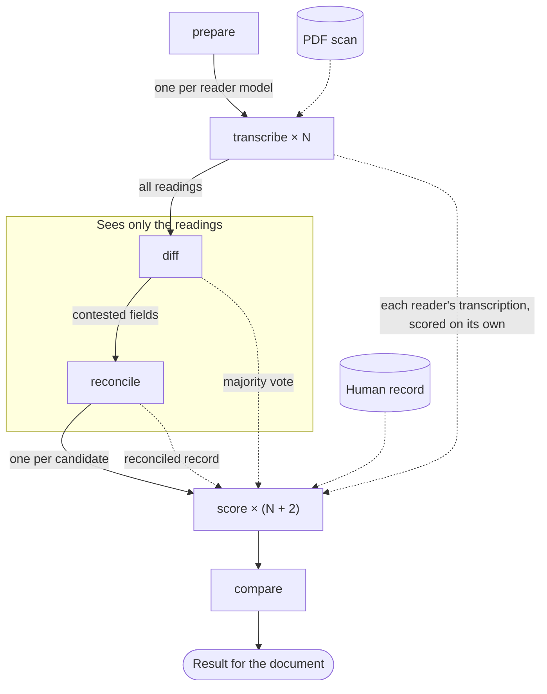
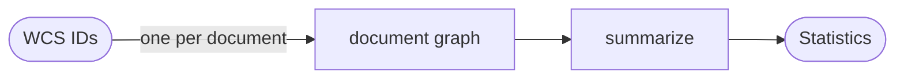

# difffish

A LangGraph workflow that compares vision-model transcriptions of handwritten
fish-collection field notes (the WCS collection).

Several models read each scanned document. An adjudicator reconciles their
readings without seeing the document. A scorer compares every reading, and the
reconciled record, with a human curator's record. The point is to find out
whether the adjudicator does better than any single model, and better than a
plain majority vote.

## What this is good for

It is a test bench for ideas that might make the transcriptions more accurate.
Each idea becomes a named run on the same documents, scored by the same scorer
against the curator's records, and `difffish compare` shows which fields were
gained and lost. The dashboard puts the scan next to every reading, so you can
see why a number moved and not only that it did.

Ideas tried so far:

- **Reconcile several models instead of trusting one.** An adjudicator that
  never sees the scan rules on the fields where readers disagree. It is compared
  with each single reader and with a plain majority vote.
- **Tell readers to study the writer's digits first** (`digits` prompt). Readers
  followed the instruction but the readings did not clearly change.
- **Rewrite the transcription prompt** (`fable-5.2-generated-prompt`): one best
  reading per field with doubts in the notes, use the sheet and the card to
  check each other, guidance for every form type.
- **Ten copies of one model instead of five different models** (`luna10`), to
  see whether repetition does the job of variety.

Ideas not built yet:

- **Enlarged tiles.** Send each page as a few overlapping crops, in case the
  model sees the whole page at too low a resolution to tell a 4 from a 9
  ([#1](https://github.com/cbizon/difffish/issues/1)).
- **A digit study field.** Make the reader write down how this writer forms
  each digit before it fills in any value
  ([#2](https://github.com/cbizon/difffish/issues/2)).
- **Readers that can look closer.** A staged re-read of fixed regions of the
  form, or an agent with a zoom tool
  ([#3](https://github.com/cbizon/difffish/issues/3)).
- **A second pass.** Send the fields the adjudicator could not settle back to
  the readers, with each other's readings or an enlarged crop.
- **Domain lists.** Give readers known collector names or place names, taken
  from a source other than the records used for scoring.

Things to keep in mind when reading a comparison:

- Twenty documents is a small sample, and an identical rerun does not reproduce
  exactly. Look at fields gained and lost, not only percentages.
- The curator's records contain some facts that are not on the scan, so no
  reader can reach 100%.
- A comparison is only fair when both runs were scored the same way. `compare`
  checks this.

## The graphs

Document graph, one run per WCS ID (`src/difffish/graph.py`):



Solid arrows are graph edges: the order the nodes run in. Dotted arrows show
what each node is given.

Every candidate gets its own scorer call against the human record: each of the
N readers' transcriptions individually, plus the majority vote and the
reconciled record. Scoring runs after `reconcile` only so that all N + 2 calls
go out together through the same node; the readers' scores do not depend on the
adjudicator.

- `prepare` — finds the PDF, its page classifications, and the human record.
- `transcribe` — one per reader model (`Send`). Renders the pages and asks the
  model for a structured record built from the form models in `forms.py`.
- `diff` — code, no model. Lines the readings up field by field and marks each
  field unanimous or contested. Fails the run if too few readers succeeded.
- `reconcile` — the adjudicator rules on the contested fields.
- `score` — one per candidate (`Send`): each reader, the majority vote, and the
  reconciled record. Verdict per human field: `exact`, `equivalent`,
  `mismatch`, or `missing`.
- `compare` — collects everything into one result for the document.

Corpus graph (`src/difffish/corpus.py`):



## Design rules

- The adjudicator never sees the document. Page images are rendered inside
  `transcribe` and never enter graph state; `diff` and `reconcile` declare an
  input schema with only the readings.
- The adjudicator never sees the human record. Only `score` receives it.
- The adjudicator sees "Reader A/B/C", not model names.
- The scorer is blind: every candidate goes through the same node with the same
  prompt and is not labelled.
- A failed reader is recorded in the result, not hidden. Below
  `DIFFFISH_MIN_READERS` successful readers, the run fails.
- A model that cannot return the structured record counts as a failed reader.
  There is no fallback to free-form output.

## Setup

```bash
uv sync
cp .env.example .env   # then fill in the endpoint, notes directory, and models
```

The API key is read from the macOS keychain item `azure-openai`, not from `.env`.

## Use

```bash
uv run difffish models                                    # what is deployed on the endpoint
uv run difffish graph                                     # both graphs as Mermaid
uv run difffish corpus --run baseline --limit 20          # run documents into a named run
uv run difffish document WCS-0005 --run baseline          # one document
uv run difffish runs                                      # list the runs
```

`corpus` saves each document as it finishes and skips documents the run
already has, so the same command extends a run or picks up after a failure.
`document` checkpoints to `.difffish/checkpoints.sqlite`; an interrupted run
resumes without repeating model calls that finished.

## Runs and comparing prompts

Every result belongs to a named run:

```
results/<run>/run.json        how the run was made
results/<run>/WCS-NNNN.json   one result per document
```

`run.json` records the reader models, adjudicator, scorer, DPI and the full
text of every prompt. A run is tied to that configuration: continuing it with
a different prompt or model is refused, so results inside a run stay
comparable. Use a new run name for a new configuration.

To try a different transcription prompt, add a text file next to
`src/difffish/data/prompts/transcribe/baseline.txt` and name it in a new run:

```bash
uv run difffish corpus --run hints --transcribe-prompt hints --limit 20
uv run difffish compare baseline hints
```

`compare` pairs the two runs on the documents they share and reports, for each
candidate and field, the share correct in each run and how many fields were
gained and lost. It refuses to compare runs scored by different scorers, since
that would measure the scorer and not the change. After changing the scorer's
prompt or model, the human records, or the vote counting, bring a run up to
date without calling the readers or adjudicator:

```bash
uv run difffish rescore --run baseline
```

## Dashboard

```bash
uv run difffish dashboard         # then open http://127.0.0.1:8765
```

Pick a run at the top. For each of its documents it shows the scan next to:

- the human record, with every candidate's own text for each field on the
  colour of the scorer's verdict (click a row for the scorer's reasons)
- each reader's transcription, the majority vote, and the reconciled value with
  the adjudicator's rationale, for contested fields or all fields
- the readers' own transcription notes

"One field" switches from the wide tables to a single field chosen from a
dropdown, with one candidate per row, for narrow screens.

"Compare runs" at the top switches to a comparison of any two runs on the
documents they share: correct share in each run, fields gained and lost, per
candidate and per field, and a list of every field that changed with both
readings side by side. Clicking a changed field opens that document at that
field. Runs scored by different scorers are reported as not comparable.

The header has the statistics across all loaded documents. The page is served
on 127.0.0.1 only, and the scans are read from `DIFFFISH_NOTES_DIR`.

`run` checkpoints to `.difffish/checkpoints.sqlite`. If a run is interrupted,
running it again resumes and does not repeat model calls that finished. Results
go to `results/`.

## Tests

```bash
uv run pytest
DIFFFISH_INTEGRATION=1 uv run pytest -m integration   # calls the endpoint
```

## Data

`src/difffish/data/` holds the page classifications and human transcriptions
for 239 documents, copied from the codburst repository. The scans themselves
are not in this repository; point `DIFFFISH_NOTES_DIR` at them.

One change from the codburst copy: the curator's `verbatimLocality` ended with
the coordinates, which are separate fields on the form. They are now split into
`verbatimLocality`, `verbatimLatitude` and `verbatimLongitude` (the Darwin Core
names), so a misread digit is scored against the coordinate and not against the
whole locality. 111 documents have coordinates; a start and end pair is joined
with " / ".

## Not done yet

- A second pass where unsettled fields go back to the readers with each
  other's readings. `Decision.settled` marks the fields that would go.
- Prompt variants for the adjudicator and scorer. Only the transcription prompt
  can be chosen per run; the others are constants recorded in the manifest.
