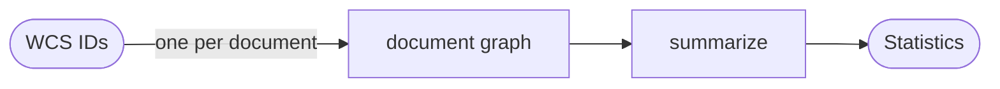

# difffish

A LangGraph workflow that compares vision-model transcriptions of handwritten
fish-collection field notes (the WCS collection).

Several models read each scanned document. An adjudicator reconciles their
readings without seeing the document. A scorer compares every reading, and the
reconciled record, with a human curator's record. The point is to find out
whether the adjudicator does better than any single model, and better than a
plain majority vote.

## The graphs

Document graph, one run per WCS ID (`src/difffish/graph.py`):


Solid arrows are graph edges: the order the nodes run in. Dotted arrows show
what each node is given.

Every candidate gets its own scorer call against the human record: each of the
N readers' transcriptions individually, plus the majority vote and the
reconciled record. Scoring runs after `reconcile` only so that all N + 2 calls
go out together through the same node; the readers' scores do not depend on the
adjudicator.

- `prepare` — finds the PDF, its page classifications, and the human record.
- `transcribe` — one per reader model (`Send`). Renders the pages and asks the
  model for a structured record built from the form models in `forms.py`.
- `diff` — code, no model. Lines the readings up field by field and marks each
  field unanimous or contested. Fails the run if too few readers succeeded.
- `reconcile` — the adjudicator rules on the contested fields.
- `score` — one per candidate (`Send`): each reader, the majority vote, and the
  reconciled record. Verdict per human field: `exact`, `equivalent`,
  `mismatch`, or `missing`.
- `compare` — collects everything into one result for the document.

Corpus graph (`src/difffish/corpus.py`):



## Design rules

- The adjudicator never sees the document. Page images are rendered inside
  `transcribe` and never enter graph state; `diff` and `reconcile` declare an
  input schema with only the readings.
- The adjudicator never sees the human record. Only `score` receives it.
- The adjudicator sees "Reader A/B/C", not model names.
- The scorer is blind: every candidate goes through the same node with the same
  prompt and is not labelled.
- A failed reader is recorded in the result, not hidden. Below
  `DIFFFISH_MIN_READERS` successful readers, the run fails.
- A model that cannot return the structured record counts as a failed reader.
  There is no fallback to free-form output.

## Setup

```bash
uv sync
cp .env.example .env   # then fill in the endpoint, notes directory, and models
```

The API key is read from the macOS keychain item `azure-openai`, not from `.env`.

## Use

```bash
uv run difffish models            # what is deployed on the endpoint
uv run difffish graph             # both graphs as Mermaid
uv run difffish run WCS-0005      # one document
uv run difffish corpus --limit 10 # several documents, then statistics
```

`corpus` saves each document's result as soon as it finishes.

After changing the scorer's prompt or model, or the human records,
`uv run difffish rescore` scores the saved results again without calling the
readers or the adjudicator.

## Dashboard

```bash
uv run difffish dashboard         # then open http://127.0.0.1:8765
```

For each document in `results/` it shows the scan next to:

- the human record, with every candidate's own text for each field on the
  colour of the scorer's verdict (click a row for the scorer's reasons)
- each reader's transcription, the majority vote, and the reconciled value with
  the adjudicator's rationale, for contested fields or all fields
- the readers' own transcription notes

"One field" switches from the wide tables to a single field chosen from a
dropdown, with one candidate per row, for narrow screens.

The header has the statistics across all loaded documents. The page is served
on 127.0.0.1 only, and the scans are read from `DIFFFISH_NOTES_DIR`.

`run` checkpoints to `.difffish/checkpoints.sqlite`. If a run is interrupted,
running it again resumes and does not repeat model calls that finished. Results
go to `results/`.

## Tests

```bash
uv run pytest
DIFFFISH_INTEGRATION=1 uv run pytest -m integration   # calls the endpoint
```

## Data

`src/difffish/data/` holds the page classifications and human transcriptions
for 239 documents, copied from the codburst repository. The scans themselves
are not in this repository; point `DIFFFISH_NOTES_DIR` at them.

One change from the codburst copy: the curator's `verbatimLocality` ended with
the coordinates, which are separate fields on the form. They are now split into
`verbatimLocality`, `verbatimLatitude` and `verbatimLongitude` (the Darwin Core
names), so a misread digit is scored against the coordinate and not against the
whole locality. 111 documents have coordinates; a start and end pair is joined
with " / ".

## Not done yet

- A second pass where unsettled fields go back to the readers with each
  other's readings. `Decision.settled` marks the fields that would go.
- Resuming a corpus run. Only single-document runs are checkpointed.
